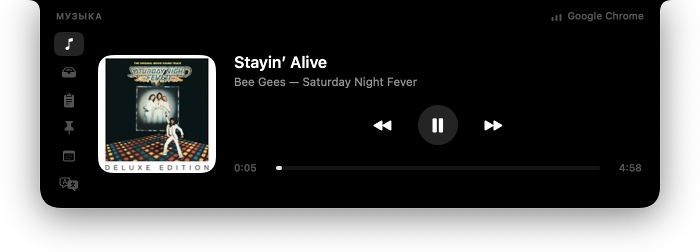

# Cyclop

*English · [Русский](README.ru.md)*

**Maintained by [semiosh](https://github.com/semiosh)** · [Source](https://github.com/semiosh/Cyclop) · [Issues](https://github.com/semiosh/Cyclop/issues)

The MacBook notch as a working tool. A native SwiftUI/AppKit app: invisible at
rest, and on hover it unfolds downwards into a panel with a player, a shelf for
files, clipboard history and translation.



**macOS 15+ · Swift 6 · SwiftUI / AppKit**

Build this version from source using the instructions below.

The track in the screenshot is playing in a browser tab — Cyclop reads it from
macOS itself, with no permissions and nothing to configure in the browser. How
that works is below.

## What it does

Four tools, with Settings separate. Hover opens the panel; only clicking switches
tabs. Clipboard is the first-launch default, then the last selected tool is
remembered. Hovering never takes keyboard focus.

| Tool | What it does |
|---|---|
| **Clipboard** | Up to 40 memory-only entries: text, files and images, including clipboard screenshots. Larger previews, dimensions, timestamps, search, expanded image preview, copy and per-item removal. Send text to Translator from the context menu. Pause, privacy cover and retention controls remain available |
| **Shelf** | One shared holding area across displays. Drop files at the notch, then drag them into another window. Command-click selects a group. The panel stays expanded until a drag ends. Removing a card never deletes the original; references survive relaunch |
| **Music** | Artwork, playback and seeking, plus output-device selection and volume when supported by the device |
| **Translator** | Paste text, detect its language, choose a language pair, swap and copy. Translation starts automatically after a 350 ms typing pause; the button or Command-Return starts it immediately, using Apple Translation on the Mac. Download language packs in System Settings |

Open tool search with the magnifier or Command-K while the panel holds keyboard
focus. The gear opens Settings. Disabled tools stop their background services.
Calendar, notes and snippets are no longer exposed or started; existing user
files are retained. Timer, teleprompter and currency conversion are absent.

## Requirements

- macOS 15 or newer (the Translate tab runs on Translation.framework)
- Swift 6 toolchain (the full Xcode is not needed, Command Line Tools are enough)

The app works on Macs without a notch too: the panel then treats a 180 × 24 pt
area at the top centre of the screen as one.

## Building

```bash
git clone https://github.com/semiosh/Cyclop.git
cd Cyclop
./Scripts/bundle.sh          # swift build + assemble the .app + ad-hoc sign
open build/Cyclop.app
```

The icon is generated in code, with no graphics editor involved:

```bash
swift Scripts/make-icon.swift "$PWD/Resources/AppIcon.icns"
```

## Installation

Build the app from this repository using the instructions above, then move
`build/Cyclop.app` to Applications.

Local builds use ad-hoc signing. On another Mac, the first launch may require
**System Settings → Privacy & Security → Open Anyway**. Developer ID signing
and notarisation require separate configuration; source builds are not
notarised automatically.

Releases of this version, when published, will appear on the
[semiosh/Cyclop releases page](https://github.com/semiosh/Cyclop/releases).

### Building the image yourself

```bash
./Scripts/dmg.sh
```

Puts `build/Cyclop-<version>.dmg` next to the app, with an `/Applications`
shortcut inside. The version number comes from `Scripts/version`.

### Cutting a release

```bash
./Scripts/release.sh
```

Builds the image, tags `v<version>` and creates a GitHub release with the `.dmg`
attached. The notes are two parts: a few lines written by hand, kept in
`docs/releases/<version>.md`, followed by the commit list GitHub assembles. The
script refuses to run without the hand-written part — a list of commits answers
"what changed in the code", while whoever arrives is asking "what does this give
me", and no generator turns the first answer into the second.

The number is written in **one place**, `Scripts/version`. From there it goes
into the app's `Info.plist`, into the image name and into the tag, so they cannot
drift apart. The script also refuses to run on a dirty tree, on unpushed commits,
or when the tag already exists.

Once published, built images will be available on the
[releases page](https://github.com/semiosh/Cyclop/releases).

## Permissions

No permissions are requested at launch. Clipboard uses NSPasteboard; primary
Now Playing uses the system helper. macOS may ask for file access when viewing
protected folders on the shelf. The media fallback can ask for player automation
or Accessibility if the primary source is unavailable. Screen Recording is not
used. Calendar and keyboard-lock services are not started in the current UI.

## How it works

Why the window is shaped the way it is, why the pointer is polled on a
timer, why Now Playing lives inside `/usr/bin/perl`, what sitting idle
costs — eighteen notes on decisions the code does not show:
**[docs/architecture.md](docs/architecture.md)**.

## Limitations

- Now Playing rests on a private framework and on `/usr/bin/perl` remaining a
  platform binary without library validation. Apple can close this in any update
  — the Music and Spotify fallback takes over then. For the same reason the app
  is unfit for the App Store.
- Apple has deprecated the scripting runtimes (perl among them) and will remove
  them from the system one day. The helper survives exactly until that moment.
- The shelf references files rather than copying them: move the original and the
  card disappears on the next launch. The exception is clipboard screenshots,
  which are saved into `~/Pictures/Cyclop` and are never deleted automatically,
  even when the card leaves the shelf. Only the user clears that folder: the
  “Clear Screenshots Folder” in Settings sends its contents to the Trash —
  a hand too, not a schedule.
- Entries typed `org.nspasteboard.ConcealedType` (password managers) never enter
  the clipboard history.
- The join button appears only if the call link is in the event itself — in the
  location field, the notes or the URL. Meet, Zoom, Teams, Webex, Whereby, Jitsi,
  Telemost and Discord are recognised.
- A screenshot from the iPhone arrives through Universal Clipboard, so it needs
  what that needs: one Apple ID, Bluetooth and Wi-Fi on, Handoff enabled and the
  devices near each other. And it overwrites the clipboard on the Mac — what was
  overwritten stays in the Clipboard tab one click away.
- macOS does not preinstall translation languages — the first time, the pack has
  to be downloaded through System Settings; the panel says so and opens the right
  screen.

## Layout

```
Sources/Cyclop
├── main.swift                 entry point, .accessory
├── App/
│   ├── AppDelegate.swift      menu bar icon, launch at login
│   └── Strings.swift          string lookup, current language
├── Notch/
│   ├── NotchGeometry.swift    notch size and every rect derived from it
│   ├── NotchPanel.swift       the NSPanel above the menu bar
│   ├── NotchRootView.swift    panel hit-testing + drag & drop destination
│   ├── PointerWatcher.swift   pointer sampling: hover and click-through
│   ├── PanelState.swift       one display's share: open, dragged onto, typing
│   ├── NotchScreenPanel.swift the panel as it stands on one display
│   └── NotchController.swift  one model, one panel per display
├── Model/
│   ├── NotchViewModel.swift
│   └── PrivacyMode.swift      hiding contents: sections and reveals
├── Services/
│   ├── MediaController.swift  picks the Now Playing source
│   ├── NowPlayingFeed.swift   runs the helper in perl, parses its stdout
│   ├── PlayerBridge.swift     fallback: AppleScript + media keys
│   ├── ShelfStore.swift
│   ├── ClipboardStore.swift
│   ├── ScreenshotVault.swift  clipboard screenshots onto disk
│   ├── SnippetStore.swift     snippets: reading and writing snippets.json
│   ├── ConfigStore.swift      settings: reading and writing config.json
│   ├── Support.swift          ~/Library/Application Support/Cyclop
│   ├── DebouncedWrite.swift   writes to disk no more often than needed
│   ├── NoteStore.swift        scratch notes: notes.json
│   ├── Translator.swift       Translation.framework, direction by script
│   ├── ScreenshotFolderWatcher.swift  screenshots saved to disk, onto the shelf
│   └── CalendarStore.swift    EventKit: next meetings and the call link
└── UI/                        NotchShape, tab panes, theme

Sources/CyclopMediaHelper
└── helper.m                   dylib for /usr/bin/perl: MediaRemote -> JSON
```

## Contributing

The rules are short and live in [CONTRIBUTING.md](CONTRIBUTING.md): what gets
taken, what does not, and what to check before sending. The main one is that
the app works without macOS permissions and without the network, and a change
that alters this is a separate conversation.

What the app reads, what it keeps and where, where it goes on the network —
[SECURITY.md](SECURITY.md). The channel for vulnerabilities is there too:
private, no issue needed.

## Licence

MIT

## Changes in the semiosh version

**Tool search** opens with the magnifier or Command-K while the panel holds
keyboard focus. Return opens the first result. It searches tool names locally.

**Clipboard** includes text, file references and copied images. Screenshots made
with **⇧⌃⌘4** appear with thumbnails: click an entry, then paste with **⌘V**.
History stays in memory, independently of optional screenshot archiving to disk.
It excludes concealed/transient/generated copies and clears on screen sleep,
session inactivity, tab disablement and quit. Settings offers pause and retention
of 15 minutes, one hour or until quit. Total content is limited to 64 MiB.
See SECURITY.md for details.

**ProMotion** uses a window-bound `CADisplayLink` for active pointer tracking,
with hints up to the display's maximum refresh rate (120 Hz on ProMotion).
macOS chooses the actual cadence. Low Power Mode, serious thermal pressure and
Reduce Motion cap this clock at 60 Hz; a distant/stationary pointer returns to
8 Hz idle sampling. Native SwiftUI animations retain system frame pacing.
On-device frame-rate and energy measurements were not performed in this environment.

Clipboard, shelf, music and translator are available. The AppKit window
architecture, privacy controls and previous user files are preserved.
No dependencies were added.

---

## Baseline

Based on [akalikbergenov/cyclop](https://github.com/akalikbergenov/cyclop) at
commit [125eb02](https://github.com/akalikbergenov/cyclop/commit/125eb02).
This version is maintained in [semiosh/Cyclop](https://github.com/semiosh/Cyclop).
Original copyright notices and the MIT licence are preserved in [LICENSE](LICENSE).
