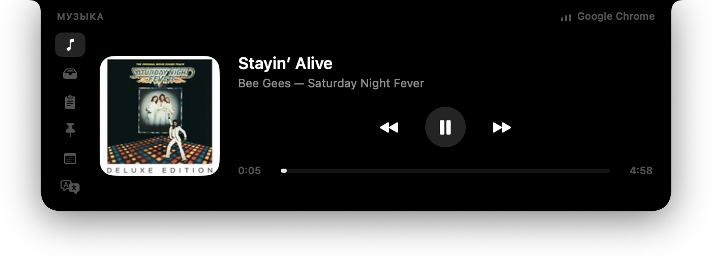

# Cyclop

*[English](README.md) · Русский*

**Версия [semiosh](https://github.com/semiosh)** · [Исходники](https://github.com/semiosh/Cyclop) · [Обсуждение ошибок](https://github.com/semiosh/Cyclop/issues)

Челка MacBook как рабочий инструмент. Нативное приложение на SwiftUI/AppKit: в покое
невидимо, по наведению мыши разворачивается вниз в панель с плеером, полкой для
файлов, историей буфера обмена и переводчиком.



**macOS 15+ · Swift 6 · SwiftUI / AppKit**

Эту версию можно собрать из исходников — инструкция ниже.

Трек на снимке играет во вкладке браузера — Cyclop читает его из самой macOS, не
требуя ни разрешений, ни настроек в браузере. Как это устроено — ниже.

## Что умеет

Четыре раздела, настройки отдельно. Панель раскрывается по наведению, вкладки
переключаются только по клику. Первое открытие — буфер, затем запоминается
последний выбранный инструмент. Наведение не забирает клавиатуру.

| Раздел | Что делает |
|---|---|
| **Буфер** | До 40 записей в памяти: текст, файлы и изображения, включая ⇧⌃⌘4. Крупные превью, размеры и время, поиск, увеличенный просмотр, копирование и удаление отдельных записей. Текст можно передать в переводчик через контекстное меню. Пауза, скрытие содержимого и срок хранения доступны в панели и настройках |
| **Полка** | Временное пространство для файлов, общее для всех экранов. Перетащите файлы к челке и заберите в другом окне. ⌘-клик выбирает группу; панель остаётся раскрытой до конца переноса. Удаление карточки не удаляет файл. Полка хранит ссылки и восстанавливает их после запуска |
| **Музыка** | Обложка, трек, воспроизведение и перемотка; выбор устройства вывода и громкость там, где её поддерживает устройство |
| **Переводчик** | Вставка из буфера, определение языка, выбор пары, смена направления, копирование результата. Перевод запускается автоматически после паузы в наборе (350 мс); кнопка и ⌘Return запускают его сразу через Apple Translation на Mac; языковые пакеты устанавливаются в системных настройках |

Поиск инструментов открывается кнопкой лупы, а при активной клавиатуре панели —
через ⌘K. Настройки доступны через шестерёнку. Неиспользуемые разделы можно
отключить; их фоновые службы также останавливаются. Календарь, заметки и
заготовки больше не входят в интерфейс, сохранённые пользовательские файлы
не удаляются. Таймер, телесуфлёр и валютный конвертер отсутствуют.

## Требования

- macOS 15 или новее (вкладка «Перевод» работает на Translation.framework)
- Swift 6 toolchain (полный Xcode не нужен, хватает Command Line Tools)

На маках без челки приложение тоже работает: панель считает челкой область
180×24 pt по центру верхней кромки экрана.

## Сборка

```bash
git clone https://github.com/semiosh/Cyclop.git
cd Cyclop
./Scripts/bundle.sh          # swift build + сборка .app + ad-hoc подпись
open build/Cyclop.app
```

Иконка генерируется кодом, без графических редакторов:

```bash
swift Scripts/make-icon.swift "$PWD/Resources/AppIcon.icns"
```

## Установка

Соберите приложение из этого репозитория по инструкции выше и перенесите
`build/Cyclop.app` в «Программы».

Локальная сборка подписана ad-hoc. На другом Mac при первом запуске может
потребоваться **Системные настройки → Конфиденциальность и безопасность →
«Всё равно открыть»**. Подпись Developer ID и нотаризация требуют отдельной
настройки; наличие исходного кода не означает, что сборка нотаризована.

Релизы этой версии, когда они будут опубликованы, появятся на
[странице релизов semiosh/Cyclop](https://github.com/semiosh/Cyclop/releases).

### Собрать образ самому

```bash
./Scripts/dmg.sh
```

Кладет `build/Cyclop-<версия>.dmg` — приложение и ярлык `/Applications` рядом.
Номер версии берется из `Scripts/version`.

### Выпустить версию

```bash
./Scripts/release.sh
```

Собирает образ, ставит тег `v<версия>` и создает релиз на GitHub с приложенным
`.dmg`. Заметки состоят из двух частей: несколько строк, написанных руками, лежат
в `docs/releases/<версия>.md`, за ними идет список коммитов, который GitHub
собирает сам. Без рукописной части скрипт откажется работать: список коммитов
отвечает на вопрос «что изменилось в коде», а пришедший спрашивает «что мне это
даст» — и второй ответ из первого не получается никаким генератором.

Номер записан **в одном месте** — `Scripts/version`. Оттуда он идет в
`Info.plist` приложения, в имя образа и в тег, поэтому разойтись они не могут.
Поднять версию — это изменить одну строку и запустить скрипт; он откажется
работать, если в дереве есть несохраненное, если коммиты не запушены или если
такой тег уже существует.

После публикации готовые образы будут доступны на
[странице релизов](https://github.com/semiosh/Cyclop/releases).

## Разрешения

При запуске разрешения не запрашиваются. Буфер читается через NSPasteboard;
основной Now Playing использует системный helper. Для файлов в защищённых
папках macOS может запросить доступ при работе с полкой. Если основной
источник музыки недоступен, запасной путь может запросить автоматизацию
плеера или универсальный доступ. Запись экрана не нужна. Службы календаря
и блокировки клавиатуры в текущем интерфейсе не запускаются.

## Как это устроено

Почему окно именно такое, почему курсор опрашивается таймером, почему
Now Playing живёт внутри `/usr/bin/perl`, во что обходится простой —
восемнадцать записок о решениях, которых по коду не видно:
**[docs/architecture.ru.md](docs/architecture.ru.md)**.

## Ограничения

- Now Playing держится на приватном фреймворке и на том, что `/usr/bin/perl`
  остается платформенным бинарником без library validation. Apple может закрыть
  это в любом обновлении — тогда включится запасной путь с Music и Spotify. По
  той же причине приложение непригодно для App Store.
- Скриптовые рантаймы (включая perl) Apple объявила устаревшими и когда-нибудь
  уберет из системы. Helper переживет это ровно до того момента.
- Полка ссылается на файлы, а не копирует их: если переместить оригинал, карточка
  исчезнет при следующем запуске. Исключение — снимки экрана из буфера обмена:
  они сохраняются в `~/Pictures/Cyclop` и не удаляются автоматически никогда,
  даже когда карточка уходит с полки. Чистит папку только пользователь: пункт
  «Очистить папку снимков» в настройках отправляет её содержимое в Корзину —
  тоже рукой, не по расписанию.
- Записи с типом `org.nspasteboard.ConcealedType` (менеджеры паролей) в историю
  буфера не попадают.
- Кнопка подключения появляется, только если ссылка на созвон есть в самом
  событии — в поле места, в заметках или в URL. Распознаются Meet, Zoom, Teams,
  Webex, Whereby, Jitsi, Телемост и Discord.
- Снимок с айфона приезжает через универсальный буфер обмена, поэтому требует
  того же, что и он: один Apple ID, включённые Bluetooth и Wi-Fi, Handoff и
  устройства рядом. И затирает буфер на маке — затёртое остаётся в истории
  «Буфера» в одном клике.
- Языки перевода macOS не предустанавливает — первый раз пакет придётся скачать
  через Системные настройки; панель говорит об этом и открывает нужный экран.

## Структура

```
Sources/Cyclop
├── main.swift                 точка входа, .accessory
├── App/
│   ├── AppDelegate.swift      иконка в меню-баре, автозапуск
│   └── Strings.swift          поиск строк в таблицах, текущий язык
├── Notch/
│   ├── NotchGeometry.swift    размеры челки и производные прямоугольники
│   ├── NotchPanel.swift       NSPanel над меню-баром
│   ├── NotchRootView.swift    hit-test панели + приемник drag&drop
│   ├── PointerWatcher.swift   опрос курсора: наведение и сквозные клики
│   ├── PanelState.swift       доля одного экрана: открыта, тянут, печатают
│   ├── NotchScreenPanel.swift панель, как она стоит на одном дисплее
│   └── NotchController.swift  одна модель, по панели на дисплей
├── Model/
│   ├── NotchViewModel.swift
│   └── PrivacyMode.swift      скрытие содержимого: разделы и раскрытия
├── Services/
│   ├── MediaController.swift  выбирает источник Now Playing
│   ├── NowPlayingFeed.swift   запуск helper в perl, разбор его stdout
│   ├── PlayerBridge.swift     запасной путь: AppleScript + медиа-клавиши
│   ├── ShelfStore.swift
│   ├── ClipboardStore.swift
│   ├── ScreenshotVault.swift  снимки из буфера на диск
│   ├── SnippetStore.swift     заготовки: чтение и запись snippets.json
│   ├── ConfigStore.swift      настройки: чтение и запись config.json
│   ├── Support.swift          ~/Library/Application Support/Cyclop
│   ├── DebouncedWrite.swift   запись на диск не чаще, чем нужно
│   ├── NoteStore.swift        временные заметки: notes.json
│   ├── Translator.swift       Translation.framework, направление по письменности
│   ├── ScreenshotFolderWatcher.swift  снимки, сохранённые на диск, на полку
│   └── CalendarStore.swift    EventKit: ближайшие встречи и ссылка на созвон
└── UI/                        NotchShape, панели вкладок, тема

Sources/CyclopMediaHelper
└── helper.m                   dylib для /usr/bin/perl: MediaRemote -> JSON
```

## Как помочь

Правила короткие и живут в [CONTRIBUTING.md](CONTRIBUTING.md): что принимается,
что нет и что проверить у себя до отправки. Главное правило — приложение
обходится без разрешений macOS и без сети, и правка, которая это меняет,
обсуждается отдельно.

О чём приложение читает, что и где хранит, куда ходит по сети — в
[SECURITY.md](SECURITY.md). Там же канал для уязвимостей: приватный, issue
заводить не нужно.

## Лицензия

MIT

## Доработки версии semiosh

**Поиск инструментов** открывается лупой или ⌘K при активной клавиатуре
панели. Return выбирает первый результат. Поиск локальный, только по названиям.

**Буфер** хранит текст, ссылки на файлы и изображения. Скриншоты по **⇧⌃⌘4**
появляются с превью: нажмите запись, затем **⌘V** в нужном приложении.
История изображений работает в памяти независимо от архивирования на диск.
Есть пауза и срок хранения: 15 минут, час или до выхода. История очищается
при сне экранов, смене сеанса, отключении вкладки и выходе. Скрытые копирования
не собираются; общий бюджет содержимого — 64 МиБ. Подробнее — SECURITY.md.

**ProMotion**: активное отслеживание указателя синхронизируется с экраном
конкретного окна через `CADisplayLink`, до доступного максимума (120 Гц на
ProMotion). Фактическую частоту выбирает macOS. При энергосбережении, сильном
нагреве или уменьшении движения предел — 60 Гц; неподвижный/далёкий указатель
возвращается к опросу 8 раз в секунду. Нативные анимации SwiftUI сохраняют
системное управление кадрами. Измерения реальной частоты и нагрузки на дисплее
в этой среде не выполнялись.

Доступны буфер, полка, музыка и переводчик. Сохранены оконная архитектура,
настройки приватности и пользовательские файлы прежних инструментов.
Новых зависимостей нет.

---

## Baseline

За основу взят [akalikbergenov/cyclop](https://github.com/akalikbergenov/cyclop),
коммит [125eb02](https://github.com/akalikbergenov/cyclop/commit/125eb02).
Эта версия развивается в [semiosh/Cyclop](https://github.com/semiosh/Cyclop).
Исходные уведомления об авторских правах и лицензия MIT сохранены в [LICENSE](LICENSE).
